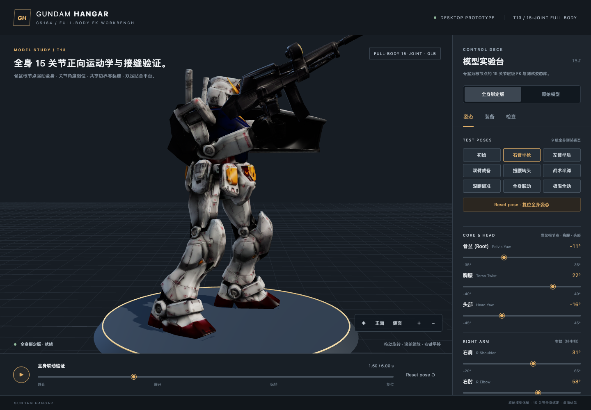
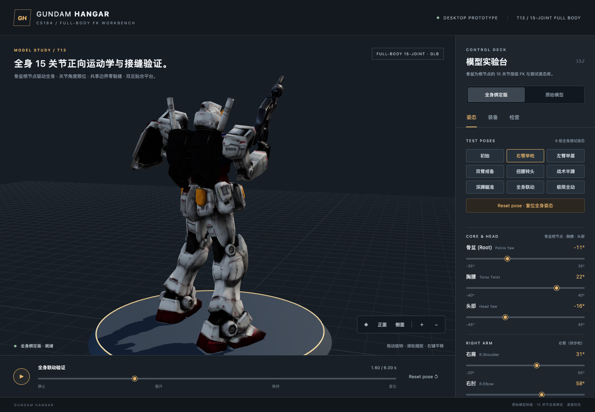

# Gundam Hangar — 当前开发进度

更新日期：2026 年 11 月 14 日（America/Los_Angeles）。本文件取代 11 月 13 日早期开发快照作为最新状态。

## 当前结果

已完成第一阶段的电脑端单臂原型：保留原模型、导出静态 GLB、创建可交互查看器、处理持枪侧肩/肘/手腕、建立武器挂点，并实现可播放、暂停、定位和复位的抬臂动作。代码和模型均已保存到正式项目目录，不再依赖临时目录作为交付物。

实际仓库：`/Users/jerrychen/Desktop/cs184/Final_Project`。

本地预览：`http://127.0.0.1:5173/`（预览服务运行时可用）。重新启动方法见 [电脑端运行指南](DESKTOP-PROTOTYPE.md)。

## 1. 已完成的功能

| 模块 | 当前结果 |
|---|---|
| 原始资产保留 | 原始 .blend 已复制到 assets-src/；SHA-256 与用户提供的文件一致 |
| 资产导出 | 原始静态 GLB 和单臂处理版 GLB 已保存，均约 15 MB |
| 查看器 | 灯光、展示台、旋转、缩放、平移、正面/侧面视角与自适应布局 |
| 模型对比 | 可在原始静态模型与处理版之间切换；原始版禁用不适用的关节和装备操作 |
| 关节控制 | 肩、肘、手腕滑块，初始/抬臂/举枪姿态预设 |
| 动画 | 6 秒抬臂—保持—回位；自主时间采样、缓动和四元数插值；播放、暂停、时间定位、复位 |
| 装备 | 原步枪通过手部挂点跟随运动；步枪和盾牌可以分别隐藏或显示 |
| 检查工具 | 线框、部件着色、关节坐标轴、武器挂点误差、共享边界误差和滚动帧间隔 |
| 可复现处理 | Blender 静态导出和单臂准备脚本；保留处理版 .blend |

## 2. 用户反馈的开裂问题与修复

用户指出肩甲、肘部及相邻位置在关节运动后出现裂口和残块。第一版按面中心进行刚性拆分，边界两侧共享的几何位置跟随不同部件，因而在运动时分离。

修复方式：

1. 通过连通性检查纠正误分的小片面，包括将 13 个误归前臂的武器面重新分配到步枪。
2. 在原始顶点索引上统一计算关节权重，再生成不同部件，确保共享顶点的各副本得到相同的变换。
3. 装甲内部尽量保持单关节影响，关节附近使用窄范围的连续权重过渡。
4. 独立步枪仍通过手部挂点运动，握持边界使用一致的腕部变换。
5. 保留原模型 9,944 个三角面、UV 与原始法线。

已从侧面、俯视和背面复核用户标出的区域。原先的运动裂口和悬浮残片已消除。当前不是完整工业级角色绑定：极端角度仍可能产生局部蒙皮形变或相互穿插，尚未实现碰撞避免。

## 3. 验证结果

| 验证 | 结果 |
|---|---|
| 严格 TypeScript 检查与 Vite 构建 | 通过 |
| 动画逻辑测试 | 8 项通过 |
| 模型与贴图加载 | 通过 |
| 共享边界连续性 | 检查 90 组边界点，4 组关节姿态通过 |
| 浏览器最大边界分离量 | 约 0.00005195 mm，处于浮点误差量级 |
| 武器跟随 | 4 组姿态下挂点位置保持一致 |
| 操作 | 装备显示、调试控件、模型切换、播放/暂停/复位通过 |
| 390px 窄屏 | 无横向溢出 |
| 浏览器异常 | 无控制台错误、无失败的 HTTP 请求 |

测试姿态（肩/肘/腕，单位度）：`0/0/0`、`20/40/0`、`30/55/0`、`55/85/20`。

动画测试覆盖插值、时间边界、缺省关节姿态、循环时间、非法关键帧、不同更新频率下的一致性，以及暂停与复位。浏览器验收采用本机无头 Chrome；不能据此宣称所有电脑或 Vision Pro 达到固定帧率。页面的滚动帧间隔仅是运行观察，不是正式性能实验。

详细记录：

- [浏览器验收数据](results/browser-validation.json)
- [Blender 资产处理与接缝验证](results/preparation-report.json)
- [原模型副本校验](results/source-copy-verification.json)
- [原模型结构检查](results/model-audit/source-inspection.json)

## 4. 交付文件

| 文件或目录 | 用途 |
|---|---|
| `src/` | 场景、模型加载、动画、共享命令与界面 |
| `assets-src/mecha-original.blend` | 未修改的原模型副本 |
| `assets-src/gundam-rigged.blend` | 可继续在 Blender 编辑的处理版 |
| `public/assets/models/mecha-original.glb` | 原始静态模型 |
| `public/assets/models/gundam-rigged.glb` | 浏览器使用的修复版 |
| `scripts/export_static.py` | 静态 GLB 导出 |
| `scripts/prepare_mecha.py` | 单臂权重、部件、挂点与导出前连续性检查 |
| `tests/animation.test.ts` | 动画逻辑测试 |
| `scripts/browser-check.mjs` | 浏览器交互和运动边界验收 |
| `docs/DESKTOP-PROTOTYPE.md` | 操作方法、运行方法与限制 |

当前代码没有使用 THREE.AnimationMixer、AnimationClip 或 KeyframeTrack。Three.js 负责渲染、数学运算和蒙皮执行；本项目实现权重准备、动画采样、控制逻辑和验证。

## 5. 任务卡状态

这是用户要求的从资产到单臂演示的集成阶段，不能把各张任务卡的完整目标全部标为完成。

- T01：项目构建与依赖已建立，严格构建通过；未来模块没有用空文件假装实现。
- T02：场景、相机、展示台、光照和交互已实现。
- T06：关键帧采样和缓动已有实际实现与测试；完整 idle 动作及任务卡的全部实验尚未完成。
- T07：当前只有抬臂动作及起播过渡，尚无完整 idle/aim/swing 状态机与切换比较。
- T09：真实模型已接入单臂原型；独立装甲换色、全部动作适配和正式性能目标尚未完成。
- T04/T05/T08/T11：有对应的部分基础功能，不宣称完整验收通过。
- T12：Vision Pro 未开始，保持桌面优先路线。

## 6. 下一阶段

1. 完善关节权重与姿态范围，检查更大角度下的外观与穿插。
2. 为装甲制作独立材质区域或遮罩，实现真正的局部换色。
3. 增加第二种武器，验证相同挂点和不同安装偏移。
4. 扩展 idle、aim、swing 动作，以及可对比的 blend/cut 切换。
5. 在固定电脑、分辨率与画质下记录性能数据。
6. 依据课程要求准备 11 月 22 日 milestone 网页、视频与 slides。
7. 电脑端稳定后再进行 Vision Pro 窗口式适配。

没有发布或推送本次应用；原有 proposal 网页及其发布工作流保持原状态。

## 7. 修复后的截图

